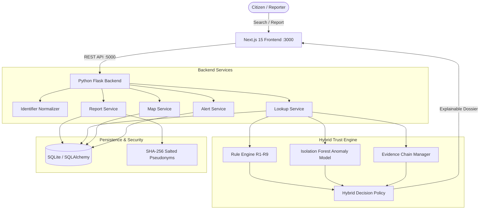

# SCAMORA — Community-Powered Scam Intelligence & Protection Platform

SCAMORA is a decentralized community intelligence and threat protection platform designed to defend Indian citizens from digital arrest, phishing, fake KYC updates, and payment fraud.

It incorporates a **Hybrid Trust Decision Engine** with **Machine Learning Anomaly Detection (Isolation Forest)**, combining rule-based heuristics, anti-sybil graph analysis, and privacy-preserving consensus to prevent malicious defamation while rapidly exposing confirmed cyber syndicates.

---

## 1. System Architecture



---

## 2. Technology Stack

- **Frontend**: Next.js 15 (App Router), TypeScript, Tailwind CSS, Lucide React, Newsreader & Plus Jakarta Sans typography.
- **Backend**: Python 3.12, Flask 3.1, Flask-CORS, SQLAlchemy 2.0, SQLite.
- **Machine Learning**: Scikit-learn (Isolation Forest), Pandas, NumPy, Joblib.
- **Testing**: Pytest automated test suite (28 passing tests).
- **Deployment**: Render-compatible WSGI / Gunicorn and Vercel/Node frontend.

---

## 3. Database Schema

- **`reports`**:
  - `report_id` (PK, string e.g. `SCM-123456`)
  - `identifier_type` (`phone`, `upi`, `url`, `sms`, `other`)
  - `identifier_value_normalized` (Indexed standard E.164 / normalized handle)
  - `scam_category` (`digital_arrest`, `fake_kyc`, `upi_refund`, `job_offer`, etc.)
  - `contact_method` (`phone`, `sms_whatsapp`, `qr`, `fake_website`, `upi_request`)
  - `description` (Optional citizen narrative)
  - `reporter_reference` (SHA-256 salted pseudonym, never raw user data)
  - `reporter_ip_hash` (Subnet-level salted hash for sybil detection)
  - `reporter_device_cluster` (Sanitized user-agent fingerprint hash)
  - `locality` & `city` (Neighborhood-level location, e.g. HSR Layout, Bengaluru)
  - `timestamp` (UTC datetime)
  - `evidence_status` (`submitted`, `verified`, `flagged`)
  - `evidence_badge` (`Independent Report`, `Telephony Pattern`, `Bank Flag`, `MHA Intelligence`)
  - `status` (`active`, `disputed`, `resolved`)

- **`verified_identifiers`**:
  - Official registries (e.g. State Bank of India `1800112211`, National Cyber Helpline `1930`, HDFC `18002026161`).

- **`challenges`**:
  - Merchant contestations and dispute resolutions.

- **`alerts`**:
  - Regional activity spikes and outbreak feeds.

- **`licenses`**:
  - Cryptographic digital software license records.

---

## 4. Hybrid Trust Engine & Rules (R1–R9)

The decision engine applies 9 configurable, testable rules before assigning any threat rating:

1. **R1 – Independent Reporter Evaluation**: Requires independent distinct human signals.
2. **R2 – Duplicate Detection**: Collapses repeated submissions from the same reporter reference to 1 vote.
3. **R3 – Network Correlation (Anti-Sybil / 5-Friends Defense)**:
   - *Crucial Guardrail*: Five reports from distinct accounts on the same subnet/tower or identical device cluster are collapsed (e.g. weight 1.0 instead of 5.0).
   - Prevents competitor smear campaigns and fake review extortion.
4. **R4 – Reporting Burst Detection**: Identifies rapid spikes (>3 reports within 30 minutes) and tags for investigation.
5. **R5 – Evidence Strength**: Boosts confidence when verified audio snippets, screenshot receipts, or bank fraud flags exist.
6. **R6 – Report Recency**: Decays historic reports using a 45-day half-life.
7. **R7 – Dispute Handling**: If a credible merchant challenge is open, automatic `KNOWN_SCAM` is locked and downgraded to `SUSPICIOUS`.
8. **R8 – External Intelligence**: Corroborates against CERT-In, PhishTank, and cyber threat repositories.
9. **R9 – Insufficient Evidence Guardrail**: Strictly prohibits `KNOWN_SCAM` if effective independent reporters < 3.

---

## 5. Machine Learning — Isolation Forest

- **File**: `backend/engine/anomaly.py` (Model: `backend/engine/anomaly_model.joblib`)
- **Trained Pipeline**: `backend/engine/train_anomaly.py`
- **Extracted Features**:
  1. `report_count_1h`: Immediate reporting velocity
  2. `report_count_24h`: Daily volume
  3. `avg_interval_seconds`: Mean inter-arrival duration between reports
  4. `duplicate_ip_ratio`: Origin concentration
  5. `duplicate_device_ratio`: Device clustering
  6. `evidence_presence_ratio`: Fraction of reports with evidence
  7. `locality_diversity`: Geographic dispersion
- **Safety Principle**: Anomaly detection identifies *unusual reporting dynamics* (bot swarms or sudden viral surges). An anomaly score alone **never** marks an identifier as guilty or fraudulent.

---

## 6. REST API Documentation

| Method | Endpoint | Description | Expected Status |
|---|---|---|---|
| `GET` | `/health` | Server health and version | `200 OK` |
| `POST` | `/reports` | Submit anonymous scam report | `201 Created` |
| `GET` | `/lookup` | Lookup phone, UPI, URL or SMS (`?query=...`) | `200 OK` (`KNOWN_SCAM`, `SUSPICIOUS`, `NO_REPORTS`, `VERIFIED_BUSINESS`) |
| `GET` | `/map` | Locality-wise scam statistics (`?category=...`) | `200 OK` |
| `GET` | `/alerts` | Recent active threat alerts | `200 OK` |
| `GET` | `/stats` | High-level platform counters | `200 OK` |
| `GET` | `/license` | License validity status | `200 OK` |
| `POST` | `/license` | Upload signed license | `201 Created` |
| `POST` | `/admin/reset` | Protected demo database re-seed | `200 OK` (Requires Bearer token) |

---

## 7. Automated Test Suite

Run all automated unit and integration tests:

```bash
python -m pytest backend/tests -v
```

**Results:**
- `test_anomaly.py`: Feature extraction, IsolationForest inference, heuristic fallback (3 passed).
- `test_license.py`: License validation, expiration 403 guard, admin reset protection (4 passed).
- `test_lookup.py`: Known scam lookup, verified business, unknown clean number, UPI scam (5 passed).
- `test_normalizer.py`: Indian phone (+91/toll-free), UPI format, URL, SMS header, masking (7 passed).
- `test_reports.py`: Phone report, UPI report, invalid validation 400, empty body (5 passed).
- `test_trust.py`: Single report guardrail, **5-friends coordinated reporting scenario**, independent consensus, active dispute hold (4 passed).
- **Total: 28 passed in ~2.5 seconds.**

---

## 8. Running the Application Locally

### A. Start Backend (Flask)
```powershell
cd C:\Users\HP\.gemini\antigravity-ide\scratch\scamora
python backend/app.py
# Running on http://127.0.0.1:5000
```

### B. Start Frontend (Next.js)
```powershell
cd C:\Users\HP\.gemini\antigravity-ide\scratch\scamora
npm run dev -- -p 3000
# Accessible at http://localhost:3000
```

---

## 9. Deployment to Render / Cloud Platforms

- **Start Command (Backend on Render)**:
  ```bash
  gunicorn --chdir backend app:create_app() --bind 0.0.0.0:$PORT --workers 2
  ```
- **Environment Variables**:
  - `DATABASE_URL`: `sqlite:///data/scamora.db` (Use persistent disk on Render)
  - `ADMIN_SECRET_TOKEN`: Secure random secret
  - `PRIVACY_SALT`: Cryptographic salt for reporter reference hashing
  - `CORS_ORIGINS`: Frontend domain (e.g. `https://scamora.vercel.app`)
  - `NEXT_PUBLIC_API_URL`: Backend URL (e.g. `https://scamora-api.onrender.com`)
